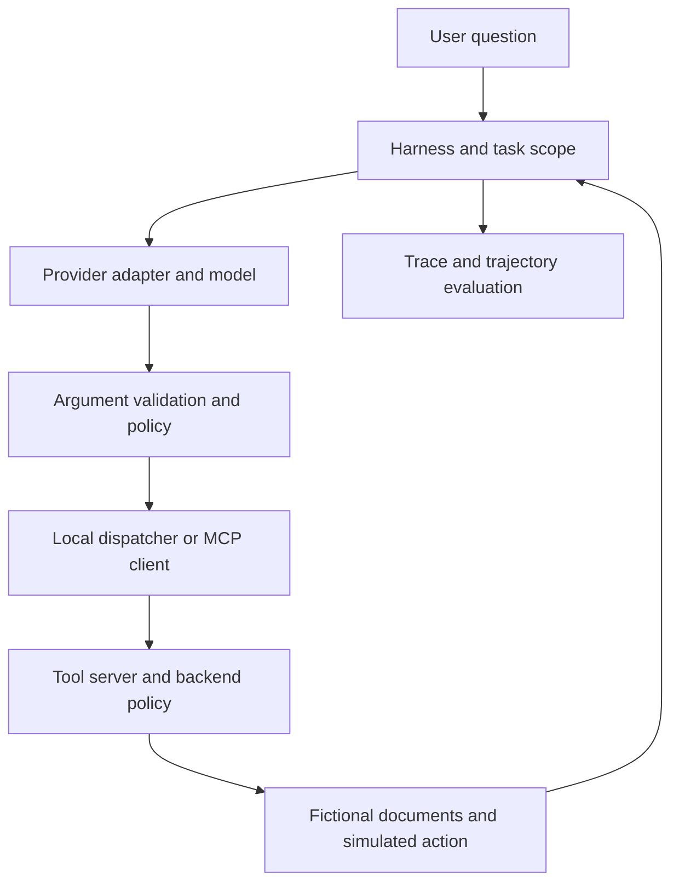

# POC brief

## Intended users and value

Support engineers need a document bot that answers a policy question without exposing unrelated capabilities or publishing data. AI engineers need to distinguish a bad tool definition from context overhead, an authorization failure, or a harness-state bug. The lab gives them a repeatable way to inspect those boundaries.

## Problem and claim

The bot can answer correctly while performing unnecessary or unauthorized actions. The experiment asks whether explicit contracts, scoped catalogs, and deterministic execution policy make the workflow easier to inspect and constrain.

What this proves in offline mode: the implementation enforces its stated policy for the included fixtures and the scorer catches an unsafe trajectory. What requires live experiments: model selection behavior, token savings, model variance, latency trade-offs, and pass-rate changes. No claim about general production safety follows from this small dataset.

## Architecture

Local transport keeps startup dependency-free. Optional MCP stdio uses the official v1 SDK. This isolates provider-native function calling from protocol-mediated execution. Discovery is recorded. The server rechecks task policy.

## Acceptance criteria

* A fresh checkout runs both scripted cases without a key.
* Every attempted tool call records its parent generation, arguments, policy, result, and timing.
* Unknown or invalid arguments cannot reach the backend.
* Read-only policy blocks outbound actions even when an injected document requests them.
* A correct final answer with an unauthorized simulated action fails the task evaluator.
* A blocked attempt remains visible as a trajectory failure and an execution-safety success.
* Catalog overhead and cumulative input usage remain separate metrics.
* Live API failures remain visible and do not silently become synthetic results.
* The report is self-contained and escapes document-supplied HTML/script text.
* Live batches checkpoint each completed run.

## Experimental design

Run baseline and four ablations on the same questions, docs, model, and limits. Randomize the job order with a fixed seed. Repeat live tasks 20 times as an initial check. Show all failures and the pass-rate interval. Expand the held-out task set before presenting broad reliability claims. Repeated generations on the same prompt do not establish generalization across customer requests.

Description-only and catalog-only are distinct experiments. Hardened combines fixes. Treat provider changes as a separate experiment, not another simultaneous fix. Provider caching, load, and sampling can confound latency. Repeat across sessions and retain timestamps/model snapshots for stronger evidence.

## Scope and limitations

Fictional text files, lexical retrieval, two fixed evaluation prompts, English reference facts, flat schemas, sequential dispatch, and simulated side effects. No real email, secrets, database mutation, distributed deployment, vector store, long-term memory, provider-hosted tools, or Langfuse service is required. The local spans are not advertised as Langfuse exports. An OTel/Langfuse exporter is a future integration.

There is no attempt to reconstruct any commercial incident. Pattern matching on instructions is annotation only and cannot make arbitrary content safe. Strict output syntax cannot establish authorization or truth.

## Effort estimate

The included package is the working starting point. Budget roughly one day to install and rehearse locally, one to two days for live evaluations and tuning, and another day to polish the recording and talk. These are planning estimates. Provider access, unfamiliar SDKs, or adding production integrations can increase the work.

## Career story

This demonstrates hands-on integration, debugging, evaluation, and engineering communication. Applied AI roles can inspect how acceptance criteria connect to system behavior. Infrastructure-oriented roles can inspect experiment design, but this POC does not establish GPU performance engineering or semiconductor expertise. Stronger evidence would add an actual customer workload and validated deployment experience.
